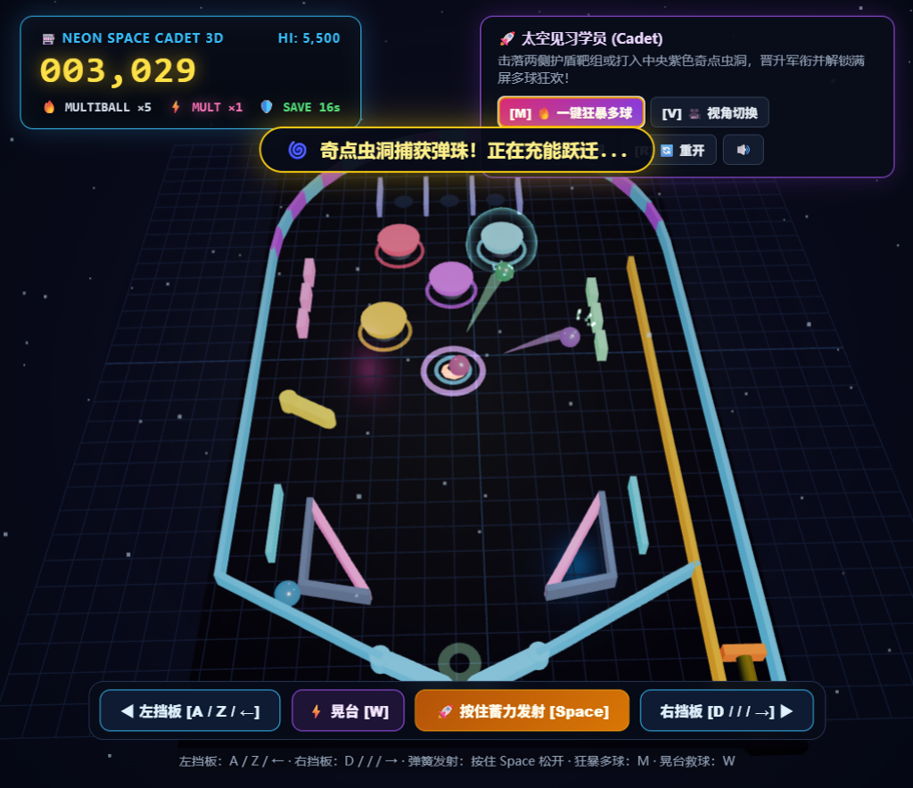

<p align="center">
  
</p>

# Neon Pinball 3D 🎰🚀（赛博霓虹三维弹珠台：太空军校生重制版）

**在线即玩地址 (GitHub Pages)**：https://dyc19991225.github.io/neon-pinball-3d/

致敬童年 Windows XP 经典 **《三维弹球：太空军校生 (3D Pinball: Space Cadet)》**，基于 **Three.js + GLSL + WebAudio** 零外部资产纯代码打造的次世代赛博霓虹三维弹珠台：搭载 **`10×` 子步解析物理引擎**（高速绝不穿模）、三挡板真实角动量击球、中央奇点虫洞军衔晋升、护盾靶组，以及一键触发满屏光轨横飞的 **🔥 HYPER MULTIBALL 狂暴多球模式**！

---

## 核心好玩亮点

### 1. `10×` 子步高精度解析弹球物理（绝不穿模 + 真实挡板角动量）
- 每帧 `10` 次连续解析子步解算圆弧发射轨道、单向防倒流闸门、三角高压弹射器（Slingshots）与双主挡板 + **左上太空军校生副挡板**；
- 真实计算挡板接触半径处的线速度传递：指尖早击可轰出跨场超音速流星球，按住挡板可稳稳控球停球（Trap & Cradle）！

### 2. 太空军校生经典机关全收录
- **🌀 中央奇点虫洞（Hyperspace Wormhole）**：吸入弹珠旋转充能并晋升军衔（`太空见习学员 → 轨道少尉 → 脉冲舰长 → 超新星指挥官 → 银河舰队统帅`），逢奇数年跃迁直接喷出多颗援军弹珠开启 **Multiball**！
- **⚡ 顶部倍率通道（Rollover Lanes）**：点亮全部 3 条通道即可提升全局得分倍率（最高 `×10`），按左右挡板可实时循环切换亮灯位置！
- **🎯 两侧护盾降落靶组（Drop Targets）**：全破一组即奖 `25,000 × 倍率` 并立刻增发一颗狂暴多球！
- **🔥 `[M]` 一键狂暴多球 + `[W]` 晃台救球（带真实 `TILT` 锁板惩罚）+ 15 秒自动护盾救球**！

### 3. `$gamefeel-3d` 100/100 [Grade S] 街机视听打击感
- **碰撞蘑菇塔体积守恒二阶弹簧压缩** + 2 帧纯白受击闪光 + GLSL 菲涅尔能量冲击环 + 切向电火花；
- **子步插值流光彗星拖尾** + GDC `Trauma²` 三轴旋转震屏 + `[T]` `0.25×` 子弹时间慢镜；
- **零 MP3 纯代码街机合成器**：电磁线圈挡板咔哒声、五声音阶递增撞柱电铃、弹簧蓄力嗡鸣与多球大奖号角！

---

## 键位操作

| 按键 / 鼠标 | 功能 |
| :--- | :--- |
| **`A` / `Z` / `←` / 鼠标左半屏** | 左主挡板 + 左上副挡板弹射 |
| **`D` / `/` / `→` / 鼠标右半屏** | 右主挡板弹射 |
| **按住 `Space` / `↓` 松开** | 弹簧发射杆蓄力弹射 |
| **`M`** | 🔥 立即触发满屏狂暴多球 (Hyper Multiball) |
| **`W` / `↑`** | ⚡ 物理晃台救球（连续猛晃会触发 `TILT` 锁死挡板！） |
| **`V` / `T` / `R`** | 切换远近视角 / 开启 `0.25×` 子弹时间 / 重开新局 |

---

## 本地运行

```bash
npm install
npm run dev
npm run build
```

## License

MIT © dyc19991225
